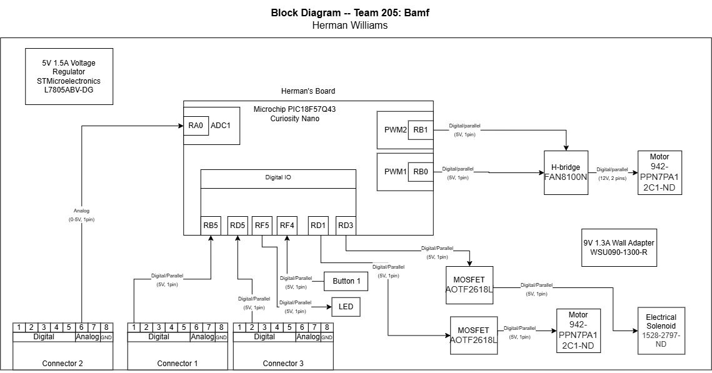

## Overview
This is my individual board. It is connected to my teammate's output signals. Specifically 2 input/output pins and one analog signal. This will be used to drive 1 bi-directional motor, 1 bi-directional solenoid, and one single direction motor. 

Block Diagram 

