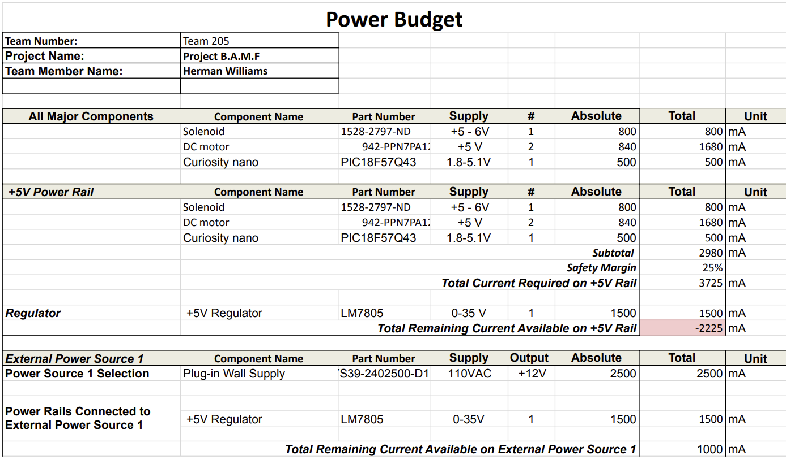

## Overview
The purpose of the power budget was to figure out how much power my components would require to function properly. I looked at the voltage and current supplied on the respecting datasheets and added it up. I compared it to the wall supply values and made sure that it was enough to power the microcontroller, the 2 motors, and the solenoid.

{style width:"350" height:"300;"}

## Conclusions

From the Power Budget, I was able to determine the ample and safe current needs and the proper way to supply them even accounting for the 25 percent safety margin.

## Resouces

The power budget as a PDF download is available [*here*](Power Budget - Power Budget.pdf), and a Microsoft Excel Sheet [*here*](Power Budget.xlsx).
